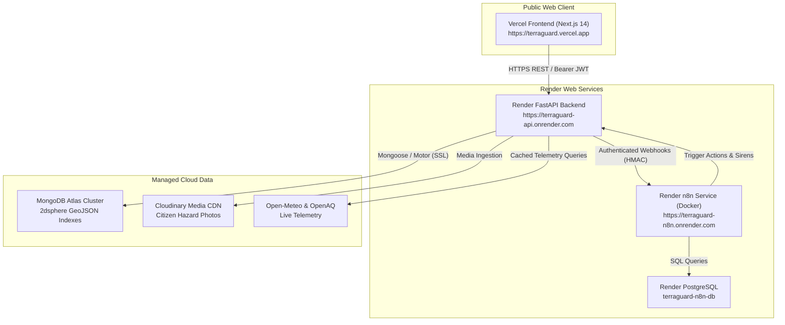

# TerraGuard AI — Production Deployment Guide

> **Target Cloud Stack:**
> - **Frontend:** [Vercel](https://vercel.com) (Next.js 14 App Router, Edge CDN)
> - **Core API Backend:** [Render](https://render.com) (FastAPI, Python 3.11, Uvicorn)
> - **Automation Engine:** [Render](https://render.com) (n8n on Docker + Managed PostgreSQL)
> - **Primary Database:** [MongoDB Atlas](https://www.mongodb.com/atlas) (Replica Set with 2dsphere GeoJSON indexes)
> - **Media Storage:** [Cloudinary](https://cloudinary.com) (Secure object storage for hazard photos)

---

## 1. Architecture Overview



---

## 2. Step 1: MongoDB Atlas Database Setup

1. **Create Cluster:**
   - Log into [MongoDB Atlas](https://cloud.mongodb.com/) and create a cluster in your preferred region (e.g. `AWS Oregon (us-west-2)`).
2. **Database & User:**
   - Database Name: `terraguard`
   - Create Database User: `terraguard_admin` with `readWriteAnyDatabase` privileges and a strong password (at least 24 characters).
3. **Network Access / IP Access List:**
   - Under **Network Access**, add `0.0.0.0/0` (Allow Access from Anywhere) or add Render's outbound IP ranges so Render web services can connect securely over TLS/SSL.
4. **Copy Connection String:**
   - Format:
     ```
     mongodb+srv://terraguard_admin:<PASSWORD>@cluster0.abcde.mongodb.net/terraguard?retryWrites=true&w=majority
     ```
5. **Geospatial Indexing:**
   - Geospatial `2dsphere` indexes on collections (`locations`, `citizen_reports`, `risk_assessments`, `alerts`) are automatically ensured at application startup by `DatabaseManager.connect()`.

---

## 3. Step 2: Render Backend & n8n Deployment (One-Click Blueprint)

TerraGuard provides a declarative [`render.yaml`](file:///c:/Users/jaswant%20karun/TerraGuard%20AI/render.yaml) blueprint that provisions the entire backend stack in a single action:

1. **Connect GitHub to Render:**
   - Go to the [Render Dashboard](https://dashboard.render.com/) and select **Blueprints** $\to$ **New Blueprint Instance**.
   - Select your TerraGuard AI repository.
2. **Render Auto-Provisions:**
   - **`terraguard-api`:** FastAPI Python 3.11 web service with automated health check at `/api/v1/health`.
   - **`terraguard-n8n-db`:** Managed PostgreSQL database for n8n workflow state and execution history.
   - **`terraguard-n8n`:** Official n8n Docker image with persistent disk (`/home/node/.n8n`).
3. **Set Environment Variables on Render:**
   Under **`terraguard-api` $\to$ Environment**:
   - `MONGODB_URI`: Your MongoDB Atlas connection string.
   - `JWT_SECRET`: Generate a 64-character random string (or click Render's generate).
   - `GEMINI_API_KEY`: Your Google AI Gemini Studio API key.
   - `CLOUDINARY_CLOUD_NAME`: Your Cloudinary cloud name.
   - `CLOUDINARY_API_KEY`: Your Cloudinary API key.
   - `CLOUDINARY_API_SECRET`: Your Cloudinary API secret.
   - `ALLOWED_ORIGINS`: `https://terraguard.vercel.app` (add custom domains comma-separated).

---

## 4. Step 3: Vercel Frontend Deployment

1. **Import Monorepo to Vercel:**
   - Go to [Vercel Dashboard](https://vercel.com/new) and click **Import Git Repository**.
   - Select your TerraGuard repository.
2. **Configure Project Settings:**
   - **Framework Preset:** Next.js
   - **Root Directory:** `apps/web` (or leave as root; [`vercel.json`](file:///c:/Users/jaswant%20karun/TerraGuard%20AI/vercel.json) handles building `apps/web`).
   - **Build Command:** `next build`
   - **Output Directory:** `.next`
3. **Set Frontend Environment Variables:**
   Add the following in Vercel Project Settings $\to$ Environment Variables:
   - `NEXT_PUBLIC_API_URL`: `https://terraguard-api.onrender.com/api/v1`
   - `NEXT_PUBLIC_API_BASE_URL`: `https://terraguard-api.onrender.com/api/v1`
   - `NEXT_PUBLIC_MAP_TILE_URL`: `https://tile.openstreetmap.org/{z}/{x}/{y}.png`
   - `NEXT_PUBLIC_DEFAULT_LAT`: `12.9716`
   - `NEXT_PUBLIC_DEFAULT_LNG`: `77.5946`
4. **Deploy:**
   - Click **Deploy**. Vercel will compile the 21 static routes and assign your domain (`https://terraguard.vercel.app`).

---

## 5. Step 4: n8n Workflow Activation & Webhook Verification

1. **Access n8n Web Console:**
   - Open your deployed n8n URL: `https://terraguard-n8n.onrender.com`.
   - Complete initial owner account setup.
2. **Import Workflow Definitions:**
   - Go to **Workflows** $\to$ **Import from File**.
   - Import the 6 production workflow templates located in [`automation/n8n/workflows/`](file:///c:/Users/jaswant%20karun/TerraGuard%20AI/automation/n8n/workflows):
     - `WF_01_ENV_MONITORING.json`
     - `WF_02_RISK_THRESHOLD.json`
     - `WF_03_CITIZEN_REPORT_PROCESSING.json`
     - `WF_04_ALERT_NOTIFICATION.json`
     - `WF_05_RESPONSE_TASK_CREATION.json`
     - `WF_06_DAILY_INTELLIGENCE_REPORT.json`
3. **Activate Workflows:**
   - Toggle each workflow to **Active** (green).
4. **Configure Shared Secret:**
   - Ensure the `X-Webhook-Secret` header configured in n8n HTTP Request nodes matches `N8N_WEBHOOK_SECRET` set on the Render FastAPI backend.

---

## 6. Post-Deployment Verification & Smoke Tests

Execute the following smoke tests against the live production URLs:

| Test Target | Verification Command / URL | Expected Result |
|---|---|---|
| **Backend Health Probe** | `curl -f https://terraguard-api.onrender.com/api/v1/health` | `HTTP 200 {"status": "healthy", ...}` |
| **Backend Root & Docs** | Open `https://terraguard-api.onrender.com/api/v1/docs` in browser | Interactive Swagger UI loads |
| **CORS Preflight** | `curl -I -X OPTIONS https://terraguard-api.onrender.com/api/v1/dashboard/summary -H "Origin: https://terraguard.vercel.app"` | `access-control-allow-origin: https://terraguard.vercel.app` |
| **Frontend Root** | Open `https://terraguard.vercel.app` | TerraGuard landing page loads smoothly with 3D map |
| **Authentication Flow** | Register new citizen account on `/register` $\to$ `/login` | Access token issued, redirects to `/dashboard` |
| **Live Telemetry Feed** | View `/dashboard` telemetry cards | Open-Meteo & OpenAQ live weather displays |
| **n8n Connectivity** | Dispatch manual trigger on `/dashboard/automation` | Workflow status changes to `SUCCESS`, log appears in table |
| **Safe Routing Engine** | Plan route on `/dashboard/navigation` | Polyline rendered with hazard penalty evaluation |

---

## 7. Security Best Practices for Production

- [x] **No Secrets in Git:** `.env` and `*.env` are strictly excluded in `.gitignore`.
- [x] **No Private Keys in Client:** `NEXT_PUBLIC_*` variables contain only public endpoints and styling URLs.
- [x] **Non-Root Docker User:** Backend Docker container runs under unprivileged `terraguard` user.
- [x] **OWASP Headers:** Strict CSP, HSTS, X-Content-Type-Options: nosniff, X-Frame-Options: DENY.
- [x] **Rate Limiting Active:** SlowAPI limits requests to 300/min per IP to prevent DoS.
- [x] **Constant-Time Webhook Auth:** HMAC comparison protects webhook endpoints from timing attacks.

